# cli-login

Browser sign-in for command-line tools without long-lived keys: PKCE, remote approval, secure storage and renewal.

## Why

Attackers who use AI tools find and exploit leaked secrets faster than before, so a stored access key is a bigger
liability than it was. A system that needs long-lived keys has to keep them safe forever. cli-login lets a CLI avoid
them. The CLI signs the person in through their browser with the authorization-code flow and PKCE, and keeps only
short-lived tokens that renew, in the operating system's secret store. A machine with no browser, such as a cloud
box running an AI agent, prints a link and a short code instead. The person approves from another device, and a
small broker hands the waiting CLI its own session without ever holding a token.

## Features

- Local browser sign-in with PKCE and a loopback callback.
- Remote sign-in for machines without a browser, approved from a phone or laptop.
- Secure storage only: macOS Keychain, Linux Secret Service, the Linux kernel keyring, a memory-only agent, or
  Windows Credential Manager. There is no plaintext fallback.
- Automatic renewal with a per-key lock, so concurrent processes do not race.
- Logout that revokes the refresh token and says so when it could not.
- A deployable broker for remote sign-in: one AWS Lambda function and one DynamoDB table.
- A written, language-neutral [broker protocol](docs/protocol.md) with conformance specs.
- No runtime dependencies.

## Install

```bash
pip install cli-login
pip install "cli-login[linux]"   # adds Secret Service support on Linux
```

Requires Python 3.10 or newer.

## Quick start

cli-login is a library, not a finished CLI. Your product describes its identity provider in a `Target`, creates a
`Session`, and mounts its own `login`, `logout` and `status` commands.

```python
from cli_login.session import Session
from cli_login.target import Target

target = Target(
    issuer="https://cognito-idp.us-east-1.amazonaws.com/us-east-1_EXAMPLE",
    client_id="example-app-client-id",
    oauth_domain="https://auth.example.com",
    token_endpoint="https://auth.example.com/oauth2/token",
    api_endpoint="https://api.example.com/graphql",
    key="production",              # names this session in the store
    namespace="mytool",            # your product; also the state directory and store name
    callback_uri="http://127.0.0.1:5182/oauth/callback",  # registered on the app client
)
session = Session(target, login_command="mytool login")

session.login()                                  # opens the browser; returns {subject, label, created_at}
headers = session.headers(target.api_endpoint)   # renews if needed; {"Authorization": ..., ...}
print(session.status())                          # {"signed_in": True, "label": ..., ...}
print(session.logout())                          # {"local_session_removed": True, "remote_revocation": ...}
```

`Session(..., api_token="access", authorization_scheme="Bearer")` sends the access token as a bearer token instead of
the ID token. `headers()` refuses an endpoint other than `target.api_endpoint`.

### Remote sign-in

Add the broker's endpoint and the HTTPS callback page your product serves, then pass the session's
`store_token_set` to `remote_login`:

```python
from cli_login.remote import RemoteLoginError, remote_login

remote_target = Target(
    # ... the fields above, plus:
    broker_endpoint="https://broker.example.com",
    remote_callback_uri="https://app.example.com/cli/callback",
)
session = Session(remote_target, login_command="mytool login --remote")

try:
    remote_login(
        remote_target,
        session.store_token_set,
        note="CI agent for the build box",       # shown to the approver
        expected_email="person@example.com",     # refuse, and store nothing, if someone else approves
    )
except RemoteLoginError as error:
    print(error)
```

It prints the approval URL and a short matching code, polls until the person approves, and stores the session.

### Enrolling each login

A product whose sign-in must enroll each login somewhere else (the Cyclotron lab enrolls each Cognito login at
Prospectus) passes `enroll` to `remote_login`, and `prepare` and `enroll` to the local `Session.login`. Both hooks
are optional, and sign-in is unchanged without them.

```python
def prepare(state):
    # `state` is the raw state. Hash it however the product needs.
    nonce, enrollment = my_product.begin_enrollment(state)
    return nonce, enrollment            # `enrollment` is opaque to cli-login

def enroll(tokens, state, enrollment):  # remote_login passes the transaction where this has the state
    my_product.finish_enrollment(tokens, enrollment)   # raise to refuse the login

session.login(prepare=prepare, enroll=enroll)
```

`prepare(state)` runs after the state and PKCE exist and before the authorize URL is built. The nonce it returns is
sent as the OpenID `nonce`, and the ID token must carry it back, or the login is refused with `nonce_mismatch`
(`remote_login` applies the same rule). `enroll(tokens, state, enrollment)` runs after the exchange and the nonce
check and before anything is stored. If it raises, nothing is stored, the tokens are discarded and the refresh
token is revoked on a best-effort basis. The library never reads the contents of `enrollment`.

## How it works

### Local browser sign-in

`Session.login()` makes a random `state` and a PKCE verifier, then opens the provider's authorization URL with the
S256 challenge (and the product's `nonce`, if a `prepare` hook supplied one). It listens on the target's loopback callback (a fixed port on `127.0.0.1` or `localhost`) for the
code, checks `state`, and exchanges the code and verifier at the token endpoint. Before saving anything it checks
that the ID token's issuer, audience, token type, subject and expiry match the target.

### Storage

Only the refresh token and a little metadata (subject, label, creation time) are stored, and only in a secure store;
see [Where sessions are stored](#where-sessions-are-stored). ID and access tokens stay in memory.

### Renewal and locking

`headers()` returns the current token and renews it with the refresh token when it is within a minute of expiry.
Each stored key has its own lock file in a private (0700) state directory, taken with `flock` on POSIX and
`msvcrt.locking` on Windows, so concurrent processes renew one at a time and a logout in one process wins over a
cached token in another. If the provider answers `invalid_grant`, the stored session is deleted and the person is
told to sign in again. `logout()` revokes the refresh token at the provider, deletes the local session either way,
and reports `confirmed`, `unconfirmed` or `not_needed`. An access token the API already accepted stays valid until
it expires.

### Remote sign-in with a split secret

The CLI keeps two secrets that never leave the machine: the PKCE verifier and a poll secret. The broker only ever
sees their hashes. The approver's browser keeps a third, a nonce in a cookie. The broker receives the
authorization code only after the approval page proves it holds that nonce, and gives it once, to the one poll that
knows the poll secret. The code is useless without the verifier.

```mermaid
sequenceDiagram
    participant CLI as CLI on the headless machine
    participant Broker as Broker
    participant Person as Approver's browser
    participant IdP as Sign-in provider

    CLI->>Broker: Start: send hashes of the verifier and poll secret, and a requester label
    Broker-->>CLI: Answer with a transaction id, a matching code and the approval URL
    CLI->>CLI: Print the approval URL and the matching code
    CLI->>Broker: Poll: ask whether the transaction is approved, sending the poll secret
    Broker-->>CLI: Answer "pending"
    Person->>Broker: Open the approval page, which asks the broker to describe the transaction
    Broker-->>Person: Show the requester label and the matching code
    Person->>Person: Check that the code matches, then press Approve
    Person->>Broker: Bind the transaction to a hash of the browser's nonce
    Person->>IdP: Sign in at the provider and return with an authorization code
    Person->>Broker: Callback page completes the transaction with the nonce and the code
    CLI->>Broker: Poll again, sending the poll secret
    Broker-->>CLI: Hand over the authorization code, once
    CLI->>IdP: Exchange the code with the verifier for tokens
    IdP-->>CLI: Answer with the tokens, which the CLI stores
```



The full contract, including the private operations and the page requirements, is in
[docs/protocol.md](docs/protocol.md). A client in another language can implement the CLI side from it and run
`features/remote_sign_in.feature`.

## Deploying the broker

Each product deployment runs one broker, built from `infra/broker.yaml`.

1. Build the Lambda zip. The build is deterministic, so the same source gives the same hash:

   ```bash
   python scripts/build_broker.py broker.zip
   ```

   It prints the SHA-256 and the `CodeKey` to use (`cli-login/broker-<sha256>.zip`). Upload the zip to your bucket
   under that key.
2. Deploy the template with these parameters:

   | Parameter | Meaning |
   | --- | --- |
   | `CodeBucket`, `CodeKey` | Where the zip is; a new key deploys new code |
   | `ClientId` | Your Cognito app client id; the broker serves only this client |
   | `Targets` | JSON list of the API endpoints a CLI may sign in to |
   | `ApprovalUrl` | Your approval page, an `https://` URL |
   | `CallbackUri` | Your callback page, registered on the app client, an `https://` URL |
   | `InvokerRoleArn` | The backend role that serves both pages and may invoke the broker |
   | `ReservedConcurrency` | Most invocations at once (default 10) |
   | `LogRetentionDays` | Log retention (default 30) |
   | `AlarmTopicArn` | Optional SNS topic told when the broker is throttled |

   The `BrokerEndpoint` output is the `broker_endpoint` in your `Target`.
3. Serve the two pages from your product's own domain. `cli_login.broker.pages.ApprovalPages` gives you
   framework-neutral handlers for `approve` and `callback`; you give it a function that invokes the broker.

The broker and the approval pages must run the same cli-login version. Products should pin an exact version, since
releases before 1.0 may change behaviour.

## Where sessions are stored

Sessions live only in a secure store, tried in this order. There is no plaintext fallback: if nothing is
usable, the tool fails with the exact steps to fix it.

| Platform | Store (in order) | Lasts |
| --- | --- | --- |
| macOS | Keychain (service name = the product namespace, so existing sessions keep working) | until logout |
| Linux | 1. Secret Service (D-Bus), needs `pip install "cli-login[linux]"` and an unlocked keyring; 2. kernel keyring; 3. the memory agent | keyring: until logout; kernel keyring: until reboot, or the persistent keyring's expiry (3 days from last use by default); agent: until it stops |
| Windows | Credential Manager (`<namespace>/<key>`; values over 2,560 bytes are chunked) | until logout |

The memory agent is not available on Windows in this version. Set `CLI_LOGIN_STORE` to `keychain`,
`secret-service`, `kernel-keyring`, `agent` or `credential-manager` to choose a store explicitly (for operators
and tests). Any other value is refused.

### Cloud machines and containers

A cloud machine usually has no desktop keyring, and Docker's default seccomp profile blocks the kernel keyring
calls. Start the memory agent once per product, then sign in again:

```bash
python -m cli_login.stores.agent serve --namespace <product-namespace> --background
python -m cli_login.stores.agent status --namespace <product-namespace>
python -m cli_login.stores.agent stop   --namespace <product-namespace>
```

A product mounts the same functions (`stores.agent.serve`, `start_background`, `status`, `stop`, `main`) under
its own CLI name, such as `<product> auth agent`. The agent holds sessions in memory only, behind a 0600 Unix
socket in a 0700 directory under the product's state directory (`~/.config/cli-login/<namespace>/agent`,
or the socket named by `CLI_LOGIN_AGENT_SOCKET`, which must sit in a private directory and be short
enough for a Unix socket). It checks the caller's user id on every connection, disables core dumps, and keeps
nothing on disk. After it stops, or the machine restarts, sign in again. Processes of the same user can use it,
as with ssh-agent.

### Recovering from each failure

- **"No Secret Service is reachable"**: no D-Bus session or keyring daemon. On a server, use the memory agent.
- **"Secret Service keyring is locked"**: unlock it by signing in to the desktop session, then retry.
- **"cli-login[linux]"**: the optional dependency is missing; `pip install "cli-login[linux]"`.
- **"kernel keyring is unavailable"**: the kernel or container blocks `add_key`/`keyctl`. Use the memory agent,
  or run the container with a seccomp profile that allows them.
- **"The memory agent is not running"**: run the `serve` command shown in the message, then sign in again.
- **Agent socket refused**: the directory or socket is not owned by you or not private; fix the mode (0700) or
  remove the stale path and restart the agent.
- **"The stored session is damaged"** (Windows): run the login command again to replace it.
- **Credential Manager errors on Windows**: sign in to Windows normally (not a restricted service account) and
  retry.

## Security model and limits

- **Whoever approves first owns the session.** The approval URL and code are often relayed through chat. The
  requester label, the matching code the approver must confirm, and `expected_email` narrow the risk. They do not
  remove it, and the CLI always prints the identity it signed in as.
- **Tokens can leak.** They are short-lived and renewable, and logout revokes the refresh token. A stolen refresh
  token works until it expires or is revoked.
- **The broker never holds a token.** It holds an authorization code until the right CLI collects it, and the
  code is useless without the verifier.
- **Cognito only, for now.** The library targets Amazon Cognito user pools with the authorization-code flow and PKCE.
- **The broker is AWS-only** (Lambda and DynamoDB), and **the client is Python-only**. The protocol is written down
  so other clients can follow it.
- **Not yet tested:** a real renewal run of 24 hours or more; the approval flow in real browsers (Chrome, Safari,
  Firefox); and the macOS Keychain store beyond fakes. The Linux Secret Service and kernel keyring run against
  real backends in CI.
- Same-user processes can use the memory agent, as with ssh-agent.

## Origins

cli-login was originally developed for the Anthus products (Papyrus and Cyclotron) and is now maintained under
DataParade-io.

## Development

```bash
python -m pip install -e ".[dev]"      # add ",linux" on Linux for Secret Service tests
python -m ruff check .
python -m pytest -q -rs
python -m behave features
```

CI runs these on Ubuntu, macOS and Windows with Python 3.10 and 3.13. On Linux it also runs against a real Secret
Service and kernel keyring.

## Releasing (maintainers)

Pushing to `main` (a pull request from `develop`) runs python-semantic-release on the conventional commits:
`feat:` and `fix:` (or a breaking change) bump the version in `pyproject.toml`, tag `vX.Y.Z` and create a GitHub
release; other commits release nothing. The `pypi` job then builds the sdist and wheel and publishes them with
OIDC trusted publishing, so no PyPI token is stored anywhere. Publishing needs a PyPI trusted publisher, registered
by the PyPI account owner: project `cli-login`, owner `DataParade-io`, repository `cli-login`, workflow
`release.yml`, environment `pypi`. The workflow's `pypi` environment must also exist in the repository settings.

## License

MIT. See [LICENSE](LICENSE).
